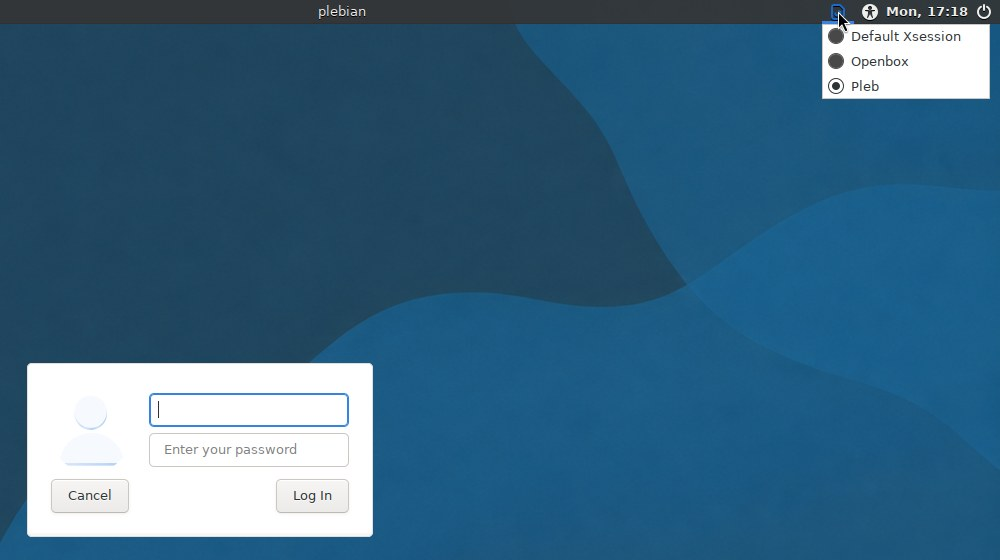

# Pleb

Pleb is a LightDM session plus the `pleb` command that make one screen-filling
[Kilix](https://github.com/itsmygithubacct/kilix#readme) the whole desktop: you
log in, and Kilix, with its clickable page strip and pane controls visible, is
the only thing on screen.

**Status:** ships in Plebian-OS as its login session. Plebian-OS 0.2.2 selects
Pleb's `v0.2.2` tag; the 0.2.3 release candidate pins commit `92c81c0e` in
[`releases/0.2.3.env`](https://github.com/itsmygithubacct/plebian-os/blob/main/releases/0.2.3.env),
and first-boot provisioning clones it to `~/.local/gpu_terminal/sources/pleb`
and runs a managed `pleb install`. Pleb also installs on its own on an existing
Debian or Ubuntu desktop that uses LightDM, as one more session at the greeter.

## What it does

- Adds **Pleb** as a choosable LightDM session; your existing desktop session
  is left untouched.
- `pleb install` clones Kilix, fetches a prebuilt kitty engine so Kilix runs
  before its fork is built, installs the pinned terminal utilities, PTY broker,
  Kilix Voice, Media Player and PDF Viewer, and puts `pleb`, `kilix`,
  `kilix-settings`, `kilix-temps`, `tmux-tui` and `tb` on `PATH`.
- Starts Kilix maximized with its own chrome visible over a deliberately bare
  Openbox, and routes ordinary graphical commands into Kilix tabs through
  `kilix run`.
- Runs desktop services for a normal login: PAM screen lock, idle and sleep
  locking, power, PolicyKit, Bluetooth, removable media, input methods, a
  consent-based screen-capture portal, and restart of a crashed Kilix frontend.
- Configures monitors with timed-preview rollback, and offers kiosk autologin
  and a hard kiosk that relaunches Kilix.
- Updates Pleb, Kilix and the desktop provider as one coordinated release
  closure, preserving local edits and rolling back on failure.

## Quick start

On Plebian-OS everything below is already done. On another LightDM desktop,
clone Pleb into the shared source root first:

```sh
git clone https://github.com/itsmygithubacct/pleb ~/.local/gpu_terminal/sources/pleb
```

```sh
~/.local/gpu_terminal/sources/pleb/bin/pleb install  # clone kilix + engine, add "Pleb" to LightDM (asks for sudo)
~/.local/gpu_terminal/sources/pleb/bin/pleb doctor   # check prerequisites (engine, X, greeter)
~/.local/gpu_terminal/sources/pleb/bin/pleb test     # try it in a throwaway X server — nothing permanent
```

Then **log out** of your current desktop, and at the LightDM greeter open the
session menu (the little badge/gear near the password box), choose **Pleb**, and
log in. To go back, log out and pick your usual session again.



> Add `~/.local/gpu_terminal/sources/pleb/bin` to your `PATH` (or alias
> `pleb=~/.local/gpu_terminal/sources/pleb/bin/pleb`) to drop the
> full path.

Requirements: Xorg, LightDM, `git`, `curl`, `tar`, a C toolchain and `sudo`;
on Debian and Ubuntu `pleb install` installs the rest with apt. Go 1.26 or
newer builds the Kilix fork engine. Details are in
[docs/install.md](docs/install.md).

## The `pleb` CLI

| Command | What it does |
|---|---|
| `pleb doctor` | Check the engine, X tools, and greeter are ready. |
| `pleb test [opts]` | Launch the session in a **throwaway** X server (see below). |
| `pleb install` | Clone Kilix + engine, install pinned unified terminal utilities, put their commands on `PATH`, and add "Pleb" to LightDM. *(sudo)* |
| `pleb uninstall` | Remove both, and any autologin config. *(sudo)* |
| `pleb autologin on [user]` | Boot straight into Pleb — no greeter (kiosk). *(sudo)* |
| `pleb autologin off` | Revert to the normal greeter. *(sudo)* |
| `pleb kiosk on` / `off` | Hard kiosk: respawn kilix if it exits (or don't). *(no sudo)* |
| `pleb update [-y] [--no-restart\|--restart] [--preserve-only]` | Preserve local checkout paths, update (including Pleb's own), rebuild the fork, and optionally restart an active kiosk. |
| `pleb update --show` / `--to X.Y.Z [--dry-run]` / `--latest` / `--rollback` | Show the selected release closure, move one published release hop, or restore the previous closure. |
| `pleb status` | Show the effective persisted engine / desktop / install / autologin / kiosk state. |
| `pleb version` | Print the release version of this checkout. |
| `pleb screen-size ...` | Show, increase, decrease, reset, or set Kilix terminal scale. |
| `pleb settings` | Toggle Kilix's top-bar widgets, pane-title buttons, and session logging. |
| `pleb displays ...` | List, arrange, preview and restore X11 monitor layouts; open a Kilix window on another output. |
| `pleb lock` | Lock the physical session with the account password. |
| `pleb screen-lock [--show\|--set on\|off\|session]` | Automatic lock settings. |
| `pleb devices TOOL` | Open `power`, `bluetooth`, `storage`, `printers`, `audio`, `input-method` or `accessibility` settings. |
| `pleb session` | Exec the session now, against the current `$DISPLAY`. |

`install`, `uninstall`, and `autologin` need root; the CLI calls `sudo` only for
the specific file operations, so you'll be prompted once.

`pleb test --xephyr` runs the session in a nested window, `pleb test --vt 9` on
a spare virtual terminal, and `pleb test --check` brings it up, verifies it and
tears it down ([docs/testing.md](docs/testing.md)).

## How it works

```
log out ──▶ LightDM greeter ──▶ pick "Pleb" ──▶ screen-filling Kilix
```

`pleb install` writes `/usr/share/xsessions/pleb.desktop` and a self-contained
`/usr/local/bin/pleb-session` launcher. At login, `pleb-session` reads
`/etc/pleb/session.env` and the user's `session.env` (operator choices) plus
`closure.env` (release pins), starts or adopts a window manager, starts the
desktop services, and runs Kilix with
`--start-as=maximized -o hide_window_decorations=yes`, so Kilix fills the
display while its page strip and pane buttons stay visible. With
`PLEB_DESKTOP=1` (the Plebian-OS default) the first page runs
`kilix desktop`, which launches the selected provider, normally Kilix 95. The
session records the processes it starts and stops them when it ends. See
[docs/session.md](docs/session.md) and
[docs/desktop-services.md](docs/desktop-services.md).

Pleb is the source of truth for "Kilix as a session"; the engine itself lives
in a separate Kilix checkout at `~/.local/gpu_terminal/sources/kilix`. Pleb's
own configuration, state, cache and data live under
`~/.local/gpu_terminal/pleb/{config,state,cache,session,data}`, with the shared
chrome settings in `~/.local/gpu_terminal/settings.conf`.

`pleb update` works on a release closure: the exact Plebian-OS, Pleb, Kilix,
Kilix 95 and other component commits and artifact pins that one Plebian-OS
release was accepted with. A hop
(`--to`, `--latest`) runs the selector from the target release's published tag,
checks that each component commit is published, and moves every pin together.
On a Plebian-OS image it then hands over to `plebian-os-update`; on a
standalone machine it applies the closure itself. Before moving any checkout it
copies local edits to a verified snapshot, and a failure restores the previous
coherent stack. See [docs/updates.md](docs/updates.md) and
[docs/RECOVERY.md](docs/RECOVERY.md). In the 0.2.3 candidate, the first
`pleb update --to` on a standalone machine that has never selected a closure is
refused; that is a recorded
[known issue](https://github.com/itsmygithubacct/plebian-os/blob/main/releases/0.2.3-notes.md#known-issues).

## Watch the episode

https://github.com/user-attachments/assets/c7fb031d-92be-4683-9730-106e65f71a70

**[Pleb: Turning Kilix into a Login Session](https://github.com/itsmygithubacct/pleb/releases/download/media-v1/03-pleb-login-session.mp4)**
— part three of *Kilix, Pleb, and Plebian-OS: A Desktop Built Inside a Terminal*, the ten-part
stack series (1920×1080, 2m46s, 9.3 MB; published as a
[media release](https://github.com/itsmygithubacct/pleb/releases/tag/media-v1) so a clone stays
small). The [full series](https://github.com/itsmygithubacct/plebian-os#watch-the-series) (31m22s)
lives on `plebian-os` and plays at [plebian-os.com](https://plebian-os.com/#watch).

## Documentation

| File | Contents |
|---|---|
| [docs/install.md](docs/install.md) | What `pleb install` sets up, requirements, uninstalling, notes and limitations (Go, engine fallback) |
| [docs/session.md](docs/session.md) | Process cleanup, screen filling, GUI apps in Kilix tabs, choosing the window manager, the native-window log |
| [docs/desktop-services.md](docs/desktop-services.md) | Screen-capture portal, desktop services, crash recovery, screen lock, device controls |
| [docs/monitor-layouts.md](docs/monitor-layouts.md) | `pleb displays`: the graphical arranger, timed preview, saved profiles, a Kilix window per output |
| [docs/kiosk.md](docs/kiosk.md) | Kiosk autologin and the hard kiosk |
| [docs/testing.md](docs/testing.md) | `pleb test` in Xephyr or on a spare VT |
| [docs/updates.md](docs/updates.md) | `pleb update`: release hops, RC tags, preservation snapshots, rollback, self-update |
| [docs/configuration.md](docs/configuration.md) | Choosing the login desktop, session logging and shared settings, every environment knob |
| [docs/RECOVERY.md](docs/RECOVERY.md) | Recovering a failed frontend, update or release hop |
| [docs/release-notes.md](docs/release-notes.md) | The 0.2.2.1 and 0.2.2 status sections that used to open this README |
| [CHANGELOG.md](CHANGELOG.md) | Changes by release |
| [assets/README.md](assets/README.md) | The bundled Plebian wallpaper and its licence notices |

## Related repositories

- [kilix](https://github.com/itsmygithubacct/kilix#readme): the terminal Pleb
  turns into a session; `pleb install` clones it.
- [kilix-95](https://github.com/itsmygithubacct/kilix-95#readme): the default
  desktop provider, cloned when the selected provider needs it.
- Optional providers Kilix installs on first use:
  [kilix-cap](https://github.com/itsmygithubacct/kilix-cap#readme),
  [kilix-tui-utils](https://github.com/itsmygithubacct/kilix-tui-utils#readme)
  (also the Temps, Memory and Music tools) and
  [kilix-land-desktop](https://github.com/itsmygithubacct/kilix-land-desktop#readme).
- [plebian-os](https://github.com/itsmygithubacct/plebian-os#readme): the
  Debian install that uses Pleb as its session and owns the release manifests
  and the OS updater.

## Part of Plebian-OS

Pleb is one of the repositories behind
[Plebian-OS](https://github.com/itsmygithubacct/plebian-os#readme), a Debian
install whose desktop is [Kilix](https://github.com/itsmygithubacct/kilix#readme)
running the [Kilix 95](https://github.com/itsmygithubacct/kilix-95#readme)
desktop through [Pleb](https://github.com/itsmygithubacct/pleb#readme).
Plebian-OS pins it in its release manifest and installs it at first boot as the
login session. The map of every repository and how it ships is on the
[components page](https://github.com/itsmygithubacct/plebian-os/blob/main/docs/components.md).

## Credits

Pleb is just glue around [**kilix**](https://github.com/itsmygithubacct/kilix) —
the Tilix-styled kitty fork that does the real work. The idea is to make kilix
the *whole* desktop instead of running it inside one, delivered here as a
**login-session option on an existing LightDM desktop** rather than as a custom
OS image.

## License

Pleb's code is released under the [MIT License](LICENSE). It is a standalone set of
scripts that *invoke* kilix at runtime — it does not include or link kilix/kitty
code (it clones kilix separately on install). kilix and kitty are licensed under
the **GPLv3** by their respective authors. The bundled Plebian wallpaper is a
separate GPL-2.0-or-later artwork distribution; its preserved notices and the
complete GPL version 2 text are in [`assets/`](assets/README.md).
